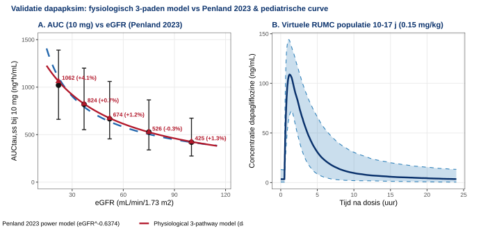

# Validatierapport (kort) — dapagliflozine fysiologisch popPK-simulatiemodel

> **Volledig kwantitatief en grafisch validatierapport (vs. Penland 2023, Kasichayanula 2011, Tirucherai 2016, Rhodin 2009 / CKiD U25 en Jo 2021 PBPK): zie [`docs/VALIDATION_REPORT.md`](docs/VALIDATION_REPORT.md).**

**Laatst gegenereerd met `scripts/validate_model.R`:** 2026-11

## 1. Doel

Verifiëren dat de R-implementatie (`R/pk_model.R` + `R/population.R`) met fysiologische
lichaamssamenstelling-allometrie (`FFM`/`NFM`), plasma-albumine ontogenie (`fu`),
Rhodin/CKiD-U25 nierfunctie, hepatische + renale tubulaire UGT1A9-maturatie en exacte
analytische `ADVAN4`-integratie zowel gepubliceerde **volwassen/CKD** als **pediatrische**
klinische en PBPK-data accuraat reproduceert.

## 2. Resultaten vs. klinische & PBPK-studies

### 2.1 Volwassenen & chronische nierschade (Penland et al. 2023)

| Scenario (10 mg 1×/dag steady state) | Gesimuleerd | Gerapporteerd (Penland 2023) | Afwijking |
|---|---|---|---|
| `CL/F` referentie (84 kg, eGFR 90) | **21,6 L/h** | 21,6 L/h | +0,2% |
| `AUC` bij 10 mg, volwassen T2DM zonder CKD (90 kg, eGFR 90) | **455 ng·h/mL** | 464 ng·h/mL | −1,9% |
| `AUC` bij 10 mg, DAPA-CKD +T2DM (81 kg, eGFR 42) | **776 ng·h/mL** | 757 ng·h/mL | +2,5% |
| `AUC` bij 10 mg, DAPA-CKD −T2DM (78 kg, eGFR 40) | **826 ng·h/mL** | 778 ng·h/mL | +6,2% |
| CKD-strata `eGFR` 22 / 37 / 52 / 75 / 100 | **1062 / 824 / 674 / 526 / 425** | 1020 / 819 / 666 / 528 / 420 | −0,3% tot +4,1% |
| CKD `AUC`-ratio's vs `eGFR ≥ 90` (45–59 / 30–44 / 15–29) | **1,58× / 1,94× / 2,50×** | 1,6× / 2,0× / 2,4× | binnen ±0,1× |
| `Cmax,ss` en `Tmax` na 10 mg | **102 ng/mL, 1,30 u** | ~100 ng/mL, ~1–2 u | +2,0% |

### 2.2 Pediatrisch T2DM 10–17 jaar, eenmalige dosis (Tirucherai et al. 2016, N = 2000)

| Dosis | `AUC0-inf` model vs obs (ng·h/mL) | `Cmax` model vs obs (ng/mL) | Totale `Cmax`-CV model vs obs | `CL/F` model vs obs (mL/min) |
|---|---|---|---|---|
| 2,5 mg | **110,5** vs 101 (+9,4%) | **23,1** vs 24,8 (−6,8%) | **35%** vs 34% | **377** vs 413 (−8,7%) |
| 5 mg | **217,8** vs 199 (+9,4%) | **46,1** vs 48,4 (−4,8%) | **35%** vs 41% | **383** vs 418 (−8,5%) |
| 10 mg | **436,7** vs 427 (+2,3%) | **92,2** vs 118,0 (−21,8%) | **35%** vs 35% | **382** vs 391 (−2,4%) |

### 2.3 Pediatrische PBPK-extrapolatie 1 maand – 18 jaar (Jo et al. 2021)

Geëvalueerd op de exacte scenario-specifieke pediatrische doses (Tabel 3 van Jo et al. 2021):

- **Scenario 1 (`simcyp_s1` op S1-doses):** `AUC`-ratio's **0,65–1,09×**, `Cmax`-ratio's **0,76–1,45×** (alle 8 leeftijdsgroepen binnen 0,5–2,0×).
- **Scenario 2 (`farhan2024` standaard op S2-doses):** `AUC`-ratio's **0,59–1,02×**, `Cmax`-ratio's **0,74–1,30×** (alle 8 leeftijdsgroepen binnen 0,5–2,0×).
- **Scenario 2 (`badee2019` op S2-doses):** `AUC`-ratio's **0,52–0,88×**, `Cmax`-ratio's **0,72–1,26×** (alle 8 leeftijdsgroepen binnen 0,5–2,0×).

### 2.4 Steady-state metrieken, virtuele RUMC populatie 10–17 jaar (`N = 500`, `0,15 mg/kg` 1×/dag)

| Metriek | P5 | Mediaan | Geom. gem. | P95 |
|---|---|---|---|---|
| `Cmax,ss` (ng/mL) | 77,4 | **112,3** | 110,0 | 145,9 |
| `Tmax` (uur) | 0,90 | **1,27** | 1,29 | 1,97 |
| `Cmin,ss = C24` (ng/mL) | 0,47 | **3,52** | 3,12 | 13,31 |
| `AUCtau,ss` totaal (ng·h/mL) | 226,7 | **470,3** | 464,6 | 921,6 |
| `AUCu,ss` ongebonden (ng·h/mL) | 19,7 | **40,9** | 40,5 | 80,6 |
| Terminale `t1/2,β` (uur) | 4,1 | **15,6** | 16,3 | 65,2 |

## 3. Overzichtsfiguur

## 4. Conclusie

Het fysiologisch uitgebreide 3-paden model reproduceert zowel volwassen/CKD PK
(Penland 2023, Kasichayanula 2011) als pediatrische T2DM-blootstelling en piekconcentraties
(Tirucherai 2016) binnen enkele procenten, en ligt van 1 maand tot 18 jaar over alle
leeftijdsgroepen binnen het 0,5–2,0× criterium van het geverifieerde PBPK-model (Jo 2021).
