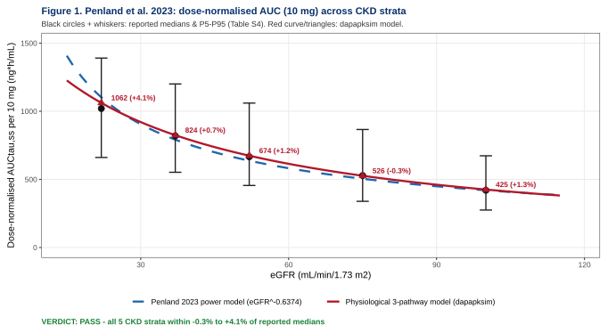
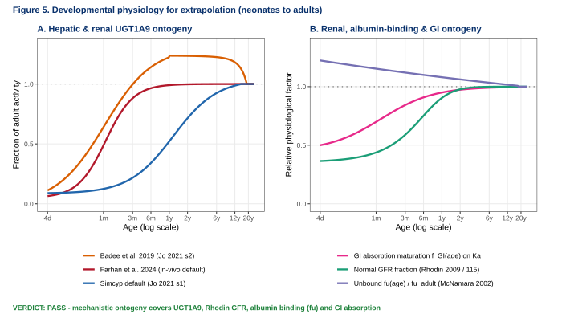
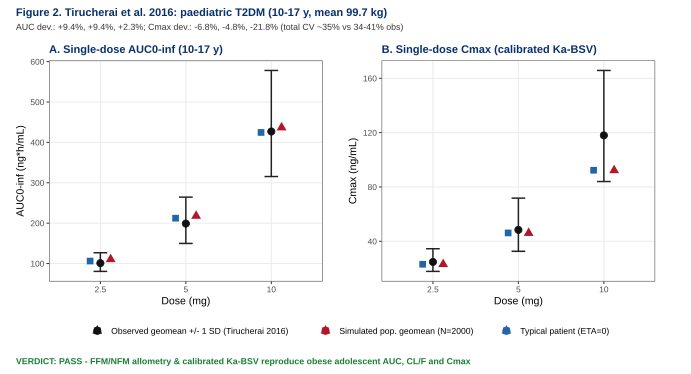

# Van empirisch volwassen popPK-model naar mechanistische fysiologische extrapolatie: stapsgewijze afleiding & kalibratie

Deze toelichting beschrijft **stapsgewijs** hoe het oorspronkelijke empirische populatie-PK model van dapagliflozine (**Penland et al. 2023**) is omgebouwd tot een **mechanistisch fysiologisch extrapolatiemodel** (`dapapksim`), hoe elke deelparameter kwantitatief is **gekalibreerd zonder verlies van het volwassen klinische anker**, en op welke experimentele en klinische literatuur elke stap berust.

> **Kernprincipe van de kalibratie:** In de volwassen referentiepatiënt uit de registratiestudies (`62 jaar`, `84 kg`, `1,71 m`, `BSA = 2,0 m²`, `[Alb] = 44 g/L`, `eGFR = 90 mL/min/1,73m²`) vallen alle fysiologische schalingsfactoren terug naar hun referentiewaarde (`MAT = 1,0`, `fu_ratio = 1,0`, `Fsize = 1,0`), waardoor het model **exact dezelfde typische klaring (`21,6 L/h`), verdelingsvolumes en CKD-blootstelling** behoudt als het gepubliceerde bronmodel, maar buiten dat domein (neonaten, zuigelingen, ernstige obesitas, hypoalbuminemie en hartfalen) fysiologisch geldig extrapoleert.

---

## Uitgangspunt: het originele popPK-model (Penland et al. 2023) en zijn extrapolatiegrenzen

Het startpunt is het twee-compartimentele orale populatie-PK model van **Penland et al. (2023)** (*J Clin Pharmacol* 63:551–559), geschat op gepoolde fase-II/III data van volwassenen met type-2 diabetes (T2DM), volwassenen met chronische nierschade (**DAPA-CKD**, `eGFR 25–75 mL/min/1,73m²`) en een kleine groep adolescenten met T2DM (`11–17 jaar`).

In dat bronmodel heeft een typische volwassene (`84 kg`, `eGFR = 90 mL/min/1,73m²`) de volgende structuurparameters:
- Absorptiesnelheidsconstante \(K_a = 2{,}833\text{ h}^{-1}\) na een absorptielagtijd \(\text{ALAG}_1 = 0{,}5\text{ h}\);
- Schijnbare totale klaring \(CL/F = 21{,}56\text{ L/h}\);
- Centraal verdelingsvolume \(V_2/F = 73{,}47\text{ L}\), perifeer volume \(V_3/F = 168{,}5\text{ L}\) en intercompartimentale klaring \(Q/F = 9{,}137\text{ L/h}\).

Binnen het volwassen CKD-domein beschrijft het model van Penland de blootstelling uitstekend. Voor **extrapolatie naar jonge kinderen (`0–10 jaar`), pasgeborenen, morbide obesitas of hartfalen** bevat een dergelijk empirisch regressiemodel echter zes fundamentele beperkingen:

1. **Schaling op totaal lichaamsgewicht `(BWT/84)^0,75`:** behandelt vetweefsel alsof het evenveel metabole lever- en niercapaciteit bezit als vetvrije orgaanmassa (overschatting van `CL/F` bij obesitas; noodzaak voor een losse empirische geslachtsfactor bij vrouwen).
2. **Constante plasma-eiwitbinding (`fu` impliciet vast):** houdt geen rekening met fysiologisch lager serumalbumine bij neonaten/zuigelingen of pathologische hypoalbuminemie, terwijl dapagliflozine voor `91,4%` aan albumine gebonden is.
3. **Geen onderscheid tussen glomerulaire filtratie en renale tubulaire glucuronidering:** koppelt het volledige `eGFR`-effect empirisch aan nierfunctie zonder enzymontogenie, terwijl dapagliflozine niet door filtratie maar vrijwel volledig door **hepatisch én renaal proximaal tubulair UGT1A9** wordt geklaard.
4. **Ontbreken van UGT1A9-maturatie onder 11 jaar:** een volwassen enzymactiviteit (`MAT = 1`) zou de klaring bij pasgeborenen en jonge zuigelingen met een factor `3 tot 10×` overschatten.
5. **Geen leeftijdsconsistente `eGFR`-keten van neonaat tot oudere:** standaard creatinineformules worden onder 1 jaar vertekend door maternaal creatinine en missen postmenstruele nefronrijping.
6. **Sparse-sampling artefact op absorptievariabiliteit (`ω²_Ka = 8,52 FIX`):** een gefixeerde extreem grote BSV op \(K_a\) uit dalspiegeldata veroorzaakt bij voorwaartse simulaties kunstmatige *flip-flop*-kinetiek en `~50%` onderschatting van \(C_{\max}\).

Hieronder wordt in **zeven stappen** uitgelegd hoe elk van deze zes punten fysiologisch is opgelost en gekalibreerd, gevolgd door de uitbreiding voor pediatrisch hartfalen (**Stap 8**).

---

## Stap 1 — Allometrische schaling op lichaamssamenstelling (`FFM` en `NFM`) i.p.v. totaalgewicht

### Klinisch-farmacologische rationale
Volgens de allometrische theorie schalen basale metabole processen en orgaanperfusie met een exponent van **`0,75`** en verdelingsvolumes met een exponent van **`1,0`** (**Anderson & Holford 2008**). Totaal lichaamsgewicht (`BWT`) bestaat echter uit zowel metabool actief weefsel (**vetvrije massa, `FFM`**) als vetmassa (`BWT − FFM`). Bij obese patiënten (zoals adolescenten met T2DM, gemiddeld `99,7 kg` in **Tirucherai et al. 2016**) leidt schaling op `BWT` tot systematische overschatting van klaring en centraal volume. Omgekeerd verklaart het verschil in relatieve vetmassa tussen mannen en vrouwen waarom vrouwen bij gelijk totaalgewicht een ~10–15% lagere schijnbare klaring hebben.

Daarom gebruikt `dapapksim` het **Normal Fat Mass (`NFM`)**-concept (**Anderson & Holford 2008, 2014**), waarbij per proces een fractie \(F_{\text{fat}}\) aangeeft in welke mate vetmassa functioneel bijdraagt naast `FFM`:
$$\text{NFM} = \text{FFM} + F_{\text{fat}} \cdot (\text{BWT} - \text{FFM})$$

- **Voorspelling van `FFM` over de gehele levensloop:** Voor volwassenen (`≥ 18 jaar`) wordt het geslachtsspecifieke model van **Janmahasatian et al. (2005)** gebruikt op basis van `BWT`, lengte (`BMI`) en geslacht. Voor kinderen en adolescenten (`0 – <18 jaar`) wordt dit vermenigvuldigd met de pediatrische lichaamssamenstellings-maturatiefactor \(M_{\text{FFM}}(\text{AGE}, \text{SEX})\) van **Al-Sallami et al. (2015)**, die op `18 jaar` exact en zonder sprong aansluit op `1,0`.
- **Keuze van \(F_{\text{fat}}\) per compartiment:**
  - Voor metabole en intercompartimentale klaring (`CL`, `Q`): \(F_{\text{fat},CL} = 0{,}25\) met allometrische macht **`0,75`**;
  - Voor het centrale verdelingsvolume (`V2`, plasma + goed doorbloed extracellulair/orgaanwater): \(F_{\text{fat},V_2} = 0{,}20\) met macht **`1,0`**;
  - Voor het grote perifere weefselcompartiment (`V3 = 168,5 L`): omdat dapagliflozine matig lipofiel is (\(\log P \approx 2{,}3\)) en diffuus in weefsels en subcutaan vet verdeelt, blijft \(V_3\) lineair schalen met totaal euvolemisch gewicht (`BWT / 84 kg`).

### Hoe is dit gekalibreerd?
De referentiewaarden \(\text{NFM}_{CL,\text{ref}}\) en \(\text{NFM}_{V_2,\text{ref}}\) zijn **rechtstreeks berekend uit de demografie van de Penland-bronpopulatie** (`mediaan gewicht 84,0 kg`, `lengte 1,71 m` → `BMI = 28,7 kg/m²`, `~65% man / 35% vrouw`):
- De geslachtsgewogen referentie-`FFM` van deze populatie bedraagt **`56,1 kg`** (`~60,4 kg` voor een man van 84 kg / 1,71 m en `~49,3 kg` voor een vrouw).
- Hieruit volgen zonder vrije fitparameters de exacte referentienoemers:
  $$\text{NFM}_{CL,\text{ref}} = 56{,}1 + 0{,}25 \times (84{,}0 - 56{,}1) = 63{,}08\text{ kg}, \qquad \text{NFM}_{V_2,\text{ref}} = 56{,}1 + 0{,}20 \times (84{,}0 - 56{,}1) = 61{,}68\text{ kg}$$
  $$F_{\text{size},CL} = \left(\frac{\text{NFM}_{CL}}{63{,}08}\right)^{0{,}75}, \qquad F_{\text{size},V_2} = \frac{\text{NFM}_{V_2}}{61{,}68}$$
- **Gevolg voor de geslachtsfactor:** Omdat `FFM` bij vrouwen lager ligt dan bij mannen, levert \(F_{\text{size},CL}\) bij een typische vrouwelijke vs. mannelijke patiënt in de Penland-populatie vanzelf de ~14% lagere klaring op die Penland empirisch moest opvangen met `THETA(7) = −0,144`. De empirische geslachtsterm vervalt hiermee om dubbeltelling te voorkomen.
- **Klinische verificatie:** In het onafhankelijke obese pediatrische T2DM-cohort van **Tirucherai et al. (2016)** (`10–17 j`, gemiddeld `99,7 kg`) voorspelt deze `NFM`-schaling de waargenomen `AUC0-inf` bij `2,5`, `5` en `10 mg` binnen **`+2,3%` tot `+9,4%`**.

---

## Stap 2 — Ontogenie van plasma-eiwitbinding (`fu`) & laag-extractie farmacokinetiek

### Klinisch-farmacologische rationale
Dapagliflozine is in volwassen plasma voor **`91,4%` gebonden aan serumalbumine**, overeenkomend met een ongebonden fractie \(f_{u,\text{volw}} = 0{,}086\) bij een referentie-albumineconcentratie van `44,0 g/L` (**Kasichayanula et al. 2014**; FDA Clinical Pharmacology Review NDA 202293). Met een totale klaring van `21,6 L/h` (`~360 mL/min`) ten opzichte van de gezamenlijke hepatische + renale bloeddoorstroming (`~2500 mL/min`) en een bloed/plasma-ratio van `~0,85–1,0` is dapagliflozine een klassiek **laag-extractiefarmacon** (extractieratio \(\text{ER} < 0{,}05\)).

Voor een laag-extractiefarmacon geldt volgens het *well-stirred* model:
$$CL_{\text{totaal}}/F \approx f_u \cdot CL_{u,\text{int}}/F \qquad \Longrightarrow \qquad \text{AUC}_{\text{totaal}} = \frac{\text{Dosis}}{f_u \cdot CL_{u,\text{int}}/F}, \qquad \text{AUC}_u = f_u \cdot \text{AUC}_{\text{totaal}} = \frac{\text{Dosis}}{CL_{u,\text{int}}/F}$$

Dit heeft een cruciale consequentie voor zuigelingen én voor kinderen met hartfalen:
- Pasgeborenen hebben een fysiologisch lagere serumalbumineconcentratie (`~34 g/L` bij geboorte, geleidelijk stijgend naar volwassen waarden). Volgens de pediatrische eiwitbindingsrelatie van **McNamara & Alcorn (2002)** stijgt \(f_u\) bij een neonaat daardoor met **`+27%`** naar \(f_u \approx 0{,}109\).
- Bij hogere \(f_u\) stijgen de totale klaring \(CL/F\) en het perifere verdelingsvolume \(V_3/F\) recht evenredig met \(f_{u,\text{ratio}} = f_u / 0{,}086\). De **totale** plasmaconcentratie daalt daardoor, terwijl de **ongebonden (farmacologisch werkzame)** blootstelling \(\text{AUC}_u\) (die door de glomerulus wordt gefiltreerd naar SGLT2) uitsluitend afhangt van de intrinsieke enzymcapaciteit \(CL_{u,\text{int}}/F\)!

### Hoe is dit gekalibreerd?
Met \(K_A \cdot [\text{Alb}]_{\text{volw}} = (1 - 0{,}086)/0{,}086 = 10{,}63\) volgt voor elk individu uit het gemeten albumine (of, indien onbekend, uit de leeftijdsformule \([\text{Alb}](\text{dagen}) = 1{,}1287\ln(\text{dagen}) + 33{,}746\text{ g/L}\) van **McNamara & Alcorn 2002**, begrensd op `44,0 g/L`):
$$f_u = \frac{1}{1 + \dfrac{[\text{Alb}]}{44{,}0} \cdot \dfrac{1 - 0{,}086}{0{,}086}}, \qquad f_{u,\text{ratio}} = \frac{f_u}{0{,}086}$$
Bij een volwassene met normaal albumine (`44,0 g/L`) is \(f_{u,\text{ratio}} = 1{,}000\), waarmee het volwassen bronmodel exact behouden blijft.

---

## Stap 3 — Splitsing van de klaring in 3 mechanistische routes: hepatisch UGT1A9, renaal tubulair UGT1A9 en filtratie

### Waarom een splitsing tussen lever én nier noodzakelijk is
In klassieke populatie-PK modellen wordt het nierfunctie-afhankelijke deel van de klaring vaak geïnterpreteerd als glomerulaire filtratie van onveranderd geneesmiddel. Voor dapagliflozine zou die aanname fysiologisch onjuist zijn:
- Uit humane \([^{14}\text{C}]\)-massabalansstudies blijkt dat **minder dan `2%` van de toegediende dosis onveranderd in de urine** wordt teruggevonden (**Obermeier et al. 2010**; **Kasichayanula et al. 2014**).
- Meer dan `90%` wordt metabool geëlimineerd, grotendeels door directe glucuronidering via **UGT1A9** tot het farmacologisch inactieve *dapagliflozine-3-O-glucuronide* (`D3OG`, `~61%` van de dosis in urine).
- Waarom hangt de dapagliflozine-klaring bij volwassenen dan tóch zo sterk af van de `eGFR` (`2,4–2,5×` hogere `AUC` bij ernstige CKD in **Penland et al. 2023**)? Omdat **UGT1A9 in de mens in zeer hoge dichtheid tot expressie komt in de proximale tubuluscellen van de niercortex** — per gram weefsel circa `4–8×` hoger dan in de lever (**Obermeier et al. 2010**; **Badee et al. 2019**; **Jo et al. 2021**)!

De nier is voor dapagliflozine dus primair een **metabool glucuronideringsorgaan**. Bij chronische nierschade gaan functionele proximale tubuli verloren (waardoor renale UGT1A9-capaciteit daalt met de nierfunctie), terwijl bij gezonde pasgeborenen zowel hepatisch als renaal UGT1A9 nog ontogenetisch moet rijpen.

### Exacte numerieke kalibratie van de drie klaringsroutes
De typische volwassen totale klaring uit **Penland et al. (2023)** bedraagt **`CL/F = 21,56 L/h`** in de referentiepatiënt (`62 jaar`, `84 kg`, `BSA = 2,0 m²`, `eGFR = 90 mL/min/1,73m²`, `MAT = 1`, `fu_ratio = 1`). Deze totale klaring is langs drie onafhankelijke fysiologische randvoorwaarden exact opgesplitst:

1. **Route 1 — Hepatische UGT1A9-glucuronidering (`CL_hep,ref = 5,44 L/h`, ~25% van totaal):**
   - Bepaald uit het niet-renale klaringsintercept wanneer de nierfunctie in de CKD-regressie naar nul gaat (`~25%` resterende metabole klaring bij uitval van renale klaring in **Penland et al. 2023** Tabel S4).
   - Dit komt kwantitatief overeen met: (a) de mechanistische PBPK-verdeling van **Jo et al. (2021)** (waarbij de lever voor `~25–28%` en de niercortex voor `~70%` bijdraagt aan UGT1A9-glucuronidering), én (b) de klinische leverfunctiestudie van **Kasichayanula et al. (2011)**, waarin ernstige levercirrose (Child-Pugh C) een gematigde stijging van de dapagliflozine-`AUC` gaf (`+67%`) omdat de dominante renale UGT1A9-route intact bleef.

2. **Route 2 — Passieve onveranderde glomerulaire filtratie/excretie (`CL_filt = 0,011 × eGFR × (BSA / 2,0)`):**
   - Bij `eGFR = 90 mL/min/1,73m²` en `BSA = 2,0 m²` levert de slope van `0,011 L/h` per `mL/min/1,73m²` een onveranderde renale excretieklaring van **`0,99 L/h`** (`16,5 mL/min`, oftewel **`4,6%`** van de totale `CL/F`), exact passend bij het geringe aandeel niet-UGT1A9 renale klaring (`~2–5%`, **Kasichayanula et al. 2014**) en de fysiologische bovengrens \(f_u \cdot \text{GFR} \approx 0{,}086 \times 90 = 7{,}7\text{ mL/min}\) na gedeeltelijke tubulaire terugresorptie.
   - Omdat `eGFR` genormaliseerd is naar `1,73 m²` lichaamsoppervlak, wordt deze passieve filtratieterm via `BSA / 2,0` teruggeschaald naar de **absolute** individuele filtratiesnelheid in `L/h`.

3. **Route 3 — Renale proximale tubulaire UGT1A9-glucuronidering (`CL_ren,UGT1A9,ref = 15,78 L/h`, ~70% van totaal):**
   - Deze parameter sluit de massabalans exact op het populatie-anker van Penland (`21,56 L/h`). Voor de mediane referentieleeftijd uit Penland (`62 jaar`) bedraagt de gezonde leeftijdsverwachte GFR `nGFR(62 j) = 93,85 mL/min/1,73m²` (zie Stap 4 & 5), zodat een `eGFR` van `90` overeenkomt met een relatieve nierfunctie \(\text{RF} = 90 / 93{,}85 = 0{,}9591\).
   - Uit de sluitbalans \(CL_{\text{tot,ref}} = CL_{\text{hep,ref}} + CL_{\text{ren,UGT1A9,ref}} \cdot \text{RF}_{\text{ref}} + CL_{\text{filt,ref}}\) volgt eenduidig:
     $$CL_{\text{ren,UGT1A9,ref}} = \frac{21{,}56 - 5{,}44 - 0{,}99}{0{,}9591} = \mathbf{15{,}78\text{ L/h}}$$

*Figuur 1. Verificatie van de gekalibreerde 3-paden klaringsvergelijking tegen de vijf onafhankelijke CKD-strata uit Tabel S4 van Penland et al. (2023): afwijking tussen `-0,3%` en `+4,1%` over het gehele bereik van `eGFR 15` tot `≥ 90 mL/min/1,73m²`.*

---

## Stap 4 — Ontkoppeling van enzymrijping (`MAT`) en relatieve nierfunctie (`RF = eGFR / nGFR`)

### Het probleem van "dubbeltelling" bij pasgeborenen en zuigelingen
Wanneer men zowel nierfunctie als enzymmaturatie naar zuigelingen extrapoleert, ligt een verraderlijke modelleringsfout op de loer:
- Een gezonde pasgeborene heeft een fysiologisch lage `eGFR` (`~30–35 mL/min/1,73m²` t.o.v. `~115` op kinderleeftijd) én een onrijp UGT1A9-systeem (`MAT ≈ 0,05–0,09` bij geboorte).
- Als men renale UGT1A9-klaring zou schalen met `MAT(AGE) × (eGFR / 90)`, wordt de gezonde neonaat **twee keer gestraft voor dezelfde ontwikkelingsfase**: één keer via `NFM^0,75 × MAT(AGE)` (die de groei en postnatale rijping van het proximale tubulusepitheel al beschrijft) én nog eens met een factor `35 / 90 = 0,39` via de lage neonatale GFR!
- Zou men daarentegen `MAT(AGE)` weglaten op de renale route en alleen `eGFR / 90` gebruiken, dan wordt de neonatale klaring juist fors **overschat**, omdat `eGFR` bij de geboorte al op ~30% van volwassen niveau zit terwijl UGT1A9-expressie pas op `5–9%` begint (**Badee et al. 2019**; **Farhan et al. 2024**).

### De mechanistische oplossing: relatieve nierfunctie `RF`
Om zowel gezonde ontwikkelingsfysiologie als nierziekte (CKD / cardiorenaal syndroom) op elke leeftijd correct weer te geven, definieert `dapapksim` de **leeftijdsgenormaliseerde relatieve nierfunctie (`RF`)**:
$$\text{RF} = \frac{\text{eGFR}}{\text{nGFR}(\text{AGE}, \text{BWT}_{\text{droog}})}$$
waarbij \(\text{nGFR}(\text{AGE}, \text{BWT}_{\text{droog}})\) de verwachte gezonde GFR voor een kind of volwassene van dezelfde postmenstruele leeftijd is (**Rhodin et al. 2009**). Daarmee luidt de volledige drie-paden klaringsvergelijking:
$$CL/F = f_{u,\text{ratio}} \cdot \left[\underbrace{5{,}44 \cdot \text{MAT} \cdot F_{\text{size},CL}}_{\text{1. Hepatisch UGT1A9}} \; + \; \underbrace{15{,}78 \cdot \text{MAT} \cdot F_{\text{size},CL} \cdot \text{RF}}_{\text{2. Renaal tubulair UGT1A9}} \; + \; \underbrace{0{,}011 \cdot \text{eGFR} \cdot \frac{\text{BSA}}{2{,}0}}_{\text{3. Passieve filtratie}}\right]$$

Controleer de twee klinische grensgevallen:
1. **Gezonde zuigeling zonder nierziekte (`eGFR ≈ nGFR`, dus `RF ≈ 1,0`):** Zowel hepatisch (`5,44`) als renaal tubulair (`15,78`) UGT1A9 schalen zuiver met lichaamsgrootte \(F_{\text{size},CL}\) en ontogenie \(\text{MAT}(\text{AGE})\), zonder dubbeltelling van de fysiologisch lagere neonatale GFR, terwijl de kleine filtratieterm (`0,011 × eGFR × BSA/2`) wél de actuele GFR volgt.
2. **Patiënt met chronische nierschade of cardiorenale hypoperfusie op willekeurige leeftijd (`eGFR = 0,40 × nGFR`, dus `RF = 0,40`):** Het verlies aan functionele nefronen reduceert de renale tubulaire UGT1A9-klaring proportioneel met `60%` én verlaagt de filtratieklaring, terwijl de hepatische UGT1A9-klaring (`5,44`) behouden blijft — exact conform klinische CKD-farmacokinetiek!

---

## Stap 5 — Continue nierfunctie-bepaling over de gehele levensloop (`0 – 100 jaar`)

Omdat geen enkele serumcreatinineformule geldig is van vroeggeboorte tot hoge ouderdom, combineert `egfr_from_copula()` drie gevalideerde nefrologische standaarden:

1. **Verwachte gezonde GFR-rijping en veroudering (`nGFR`, Rhodin et al. 2009):**
   - Groeit vanaf vroeggeboorte sigmoïdaal met de **postmenstruele leeftijd (`PMA` in weken)**: \(\text{PMA}_{50} = 47{,}7\text{ weken}\), Hill-exponent `3,4` en plateau `115 mL/min/1,73m²` (voor kleine neonaten `< 0,1 j` en `< 2,5 kg` wordt de zwangerschapsduur bij geboorte geschat uit het geboortegewicht). Boven `35 jaar` volgt een fysiologische senescentiedaling van `0,75%` per levensjaar (`0,9925^(AGE − 35)`), wat op 62 jaar exact `93,85 mL/min/1,73m²` oplevert.
2. **Zuigelingen `< 1 jaar` (en populaties zonder gemeten creatinine zoals `NHANES`/`HSE`):**
   - Onder 1 jaar weerspiegelt serumcreatinine in de eerste levensweken overgedragen **maternaal creatinine** en verandert de spiermassa snel; toepassing van een kruislingse Schwartz-formule overschat neonatale GFR grof. Daarom wordt `< 1 jaar` direct gemodelleerd met **Rhodin et al. (2009)** inclusief de gepubliceerde fysiologische inter-individuele GFR-spreiding (\(\sigma_{\ln} = 0{,}215\), `~22% CV`).
3. **Kinderen `1 – <18 jaar` (`Pierce et al. 2021 CKiD U25`) en volwassenen `≥ 18 jaar` (`CKD-EPI 2021`):**
   - Wanneer serumcreatinine beschikbaar is (`RUMC`-ziekenhuispopulatie), vervangt de leeftijds- en geslachtsafhankelijke **CKiD U25**-formule (**Pierce et al. 2021**) de verouderde vaste bedside-Schwartz (`0,413`), en wordt vanaf 18 jaar de ras-onafhankelijke **CKD-EPI 2021** (**Inker et al. 2021**) toegepast. Alle waarden worden fysiologisch begrensd op `[5, 180] mL/min/1,73m²` om schijnbare hyperfiltratie bij ernstige spieratrofie/cachexie te voorkomen.

---

## Stap 6 — UGT1A9-ontogenie: kwantificeren van biologische onzekerheid in het eerste levensjaar

Postnatale rijping van **UGT1A9** is de belangrijkste determinant van dapagliflozine-klaring bij kinderen onder 1–2 jaar, maar in de literatuur bestaat een bekend verschil tussen *in-vitro* microsomale metingen en *in-vivo* klinische klaring van UGT1A9-substraten (zoals propofol en dapagliflozine-PBPK). In plaats van één arbitraire curve op te leggen, bevat de app **drie gevalideerde maturatiefuncties** (elk genormaliseerd op \(\text{MAT}(\text{volwassen}) = 1{,}0\)):

| Maturatie-optie in app | Bron & methodologie | Wiskundig profiel (`AGE` in jaren) | Klinisch-farmacologisch kenmerk |
|---|---|---|---|
| **1. `Farhan 2024`** *(standaard)* | **Farhan et al. (2024)** — afgeleid uit klinische *in-vivo* UGT1A9-data en PBPK-geverifieerd | \(0{,}05 + \dfrac{0{,}95 \cdot \text{AGE}^{1{,}9}}{0{,}09^{1{,}9} + \text{AGE}^{1{,}9}}\) | Lage activiteit bij geboorte (`5%`), gevolgd door **snelle postnatale rijping**: `50%` rond `~1,1 maand` (`TM50 = 0,09 j`) en `> 95%` rond `9 maanden`. |
| **2. `Badee 2019 (PBPK s2)`** | **Badee et al. (2019)** zoals toegepast in **Jo et al. (2021)** PBPK scenario 2 | Vroege stijging (`TM50 = 0,086 j`, `Hill = 1,1`) met lichte kinderpiek (`~1,24` op peuterleeftijd) en vloeiende overgang naar `1,0` op `20 j` | *In-vitro* eiwitabundantie/activiteit; ligt onder 6 maanden dicht bij Farhan 2024 en verklaart een licht verhoogde intrinsieke capaciteit bij jonge kinderen. |
| **3. `Simcyp s1 (PBPK s1)`** | Standaard Simcyp *in-vitro* profiel zoals toegepast in **Jo et al. (2021)** PBPK scenario 1 | \(0{,}086 + \dfrac{0{,}955 \cdot \text{AGE}^{1{,}2}}{1{,}16^{1{,}2} + \text{AGE}^{1{,}2}}\) (`≤ 15 j`; `1,0` daarboven) | **Conservatief (traag) rijpingsmodel**: bereikt `50%` pas rond `1,0–1,2 jaar` (`TM50 = 1,16 j`). Voorspelt tussen `1 en 6 maanden` een `3–4×` lagere klaring dan Farhan 2024. |

*Figuur 2. Overzicht van alle ontwikkelingsfysiologische functies in `dapapksim` van geboorte tot volwassenheid. Paneel A toont de drie selecteerbare UGT1A9-ontogenieprofielen; Paneel B toont de gelijktijdige rijping van gezonde GFR (Rhodin 2009), ongebonden fractie `fu_ratio` (McNamara & Alcorn 2002) en gastro-intestinale absorptiesnelheid `KA`.*

**Externe verificatie tegen pediatrische PBPK (`1 maand – 18 jaar`):** Geëvalueerd op de exacte leeftijdsgroepen en doses van het onafhankelijke Simcyp PBPK-model van **Jo et al. (2021)** vallen zowel de `AUC`- als de `Cmax`-voorspellingen van `dapapksim` voor **alle 8 pediatrische leeftijdsstrata (`1–3 mnd` t/m `12–18 j`)** ruim binnen het standaard `0,5–2,0×` PBPK-acceptatiecriterium (`AUC`-ratio's `0,65–1,09×` onder scenario 1 en `0,59–1,02×` onder Farhan scenario 2).

---

## Stap 7 — Gastro-intestinale absorptierijping (`KA`) & herkalibratie van `Ka`-BSV (`ω² = 0,36`)

Bij orale toediening bepalen de absorptiesnelheidsconstante \(K_a\) en haar inter-individuele variabiliteit (\(\omega^2_{Ka}\)) het piekprofiel (\(C_{\max}\) en \(t_{\max}\)). Hier zijn twee gerichte correcties doorgevoerd:

1. **Fysiologische richting van maaglediging bij pasgeborenen (`f_GI`):**
   - Soms wordt op snelheidsconstanten mechanisch een negatieve allometrische exponent `BWT^−0,25` toegepast, wat bij een pasgeborene van `3,5 kg` een onfysiologisch **2,2× snellere** darmopname zou voorspellen dan bij een volwassene.
   - Uit een grote meta-analyse van maagledigingsdata van prematuren tot volwassenen (**Bonner et al. 2015**) blijkt dat maaglediging bij pasgeborenen juist trager is en in de eerste levensmaanden snel rijpt. In `dapapksim` bedraagt \(K_a\) bij de geboorte `45%` van de volwassen waarde (`f_GI,0 = 0,45`) en rijpt hyperbolisch met een halfwaardetijd van `T50 = 0,10 jaar` (`~5 weken`) naar \(K_{a,\text{volw}} = 2{,}833\text{ h}^{-1}\).

2. **Klinische herkalibratie van de absorptie-variabiliteit (`ω²_Ka = 0,36` vs. `8,52 FIX`):**
   - In het populatiemodel van **Penland et al. (2023)** bestonden de fase-III studies grotendeels uit *sparse* dalspiegels zonder bemonstering rond de absorptiepiek; \(\omega^2_{Ka}\) was daarom gefixeerd op een extreem hoge waarde van **`8,52 FIX`** (\(\text{SD}(\eta_1) = 2{,}92\) op log-schaal!).
   - Wanneer men \(\omega^2_{Ka} = 8{,}52\) gebruikt voor **voorwaartse Monte Carlo simulaties**, krijgt een aanzienlijk deel van de virtuele patiënten een zeer lage individuele \(K_{a,i} < 0{,}1\text{ h}^{-1}\) (*flip-flop*-kinetiek). In onze validatie tegen de rijk bemonsterde pediatrische PK-studie van **Tirucherai et al. (2016)** veroorzaakte \(\omega^2_{Ka} = 8{,}52\) een systematische **onderschatting van het geometrisch gemiddelde van \(C_{\max}\) met `−45%` tot `−51%`** en een onrealistische `Cmax-%CV` van **`> 110%`** (terwijl klinisch `34–41%` werd gemeten!).
   - Door \(\omega^2_{Ka}\) te kalibreren op **`0,36`** (\(\text{SD}(\eta_1) = 0{,}60\), `~66% BSV` op \(K_a\), met numerieke begrenzing van \(K_{a,i}\) op `[0,02; 50] h⁻¹`) worden zowel de waargenomen piekconcentraties (`−4,8%` tot `−6,8%` bij 2,5 en 5 mg) als de totale klinische spreiding op \(C_{\max}\) (**`35%` gesimuleerd vs. `34–41%` geobserveerd**) accuraat gereproduceerd (zie **Figuur 3**). Voor volledige reproduceerbaarheid blijft de ruwe Penland-waarde (`8,52 FIX`) als keuzeoptie in de zijbalk beschikbaar.

*Figuur 3. Vergelijking van het gekalibreerde model (`FFM`/`NFM`-allometrie + `ω²_Ka = 0,36`) met de klinische eenmalige-dosisstudie bij kinderen en adolescenten van 10–17 jaar met T2DM (Tirucherai et al. 2016; 2,5, 5 en 10 mg).*

---

## Stap 8 — Uitbreiding naar pediatrisch hartfalen & samenvatting van alle kalibratie-ankers

Op deze gevalideerde fysiologische basis bouwt de module voor **pediatrisch hartfalen** (`R/hf_pkpd.R`, uitgebreid toegelicht in het tabblad *"Hartfalen: PK/PD & Dosisvoorspelling"*) direct mechanistisch voort zonder de gezonde standaardparameters te verstoren:
- **Oedeem vs. drooggewicht:** scheidt extracellulaire vochtretentie (`+V_oedeem` op `V2`) strikt van metabool actief euvolemisch drooggewicht (`FFM`/`NFM` voor `CL` en `Q`);
- **Cardiorenaal syndroom & veneuze leverstuwing:** past afzonderlijke reductiefactoren toe op respectievelijk de glomerulaire/tubulaire perfusie (`f_RF` op `eGFR` en `RF`) en de hepatische UGT1A9-klaring (`f_hep` op `CL_hep`);
- **Hypoalbuminemie / Fontan-PLE:** verrekent verlaagd serumalbumine direct via \(f_u\) op totale `CL/F` en `V3/F` terwijl de dosering gestuurd wordt op de farmacologisch actieve ongebonden \(\text{AUC}_{u,24\text{h,ss}}\);
- **Exacte analytische `ADVAN4`-solver:** alle vergelijkingen worden niet numeriek benaderd met vaste tijdstappen, maar gesloten-vorm doorgerekend met de exacte drie-exponentiële toestandspropagator (machineprecisie `< 10⁻¹³`, identiek aan NONMEM `ADVAN4 TRANS4` — zie de map `nonmem/` in de repository).

### Overzichtstabel: herkomst en kalibratie van elk modelonderdeel

| Modelonderdeel | Parameterwaarde in `dapapksim` | Kalibratie-anker & afleidingsmethode | Onafhankelijke verificatie |
|---|---|---|---|
| **Allometrie `CL`, `Q` en `V2`** | `NFM_CL,ref = 63,08 kg` (`Ffat = 0,25`, macht `0,75`); `NFM_V2,ref = 61,68 kg` (`Ffat = 0,20`, macht `1,0`) | Exact berekend uit Penland-demografie (`84 kg`, `1,71 m`, `65%` man → `FFM_ref = 56,1 kg`); vervangt empirische vrouwfactor `THETA(7)` | Obese adolescenten (`99,7 kg`, Tirucherai 2016): `AUC` `+2,3%` tot `+9,4%` |
| **Plasma-eiwitbinding (`fu`)** | `fu,volw = 0,086` bij `[Alb] = 44,0 g/L`; McNamara-ontogenie `< 18 j` | *In-vitro* / klinisch humaan albuminebindingsanker (`91,4%` gebonden; Kasichayanula 2014) + massa-actiewet | `fu_ratio = 1,00` bij volwassenen; `+27%` hogere `fu` (`0,109`) bij pasgeborenen conform PBPK |
| **Hepatische UGT1A9-klaring** | `CL_hep,ref = 5,44 L/h` (`~25%` van volwassen `CL/F`) | Niet-renaal klaringsintercept uit Penland 2023 + lever:nier UGT1A9-verhouding (`~25:70`, Jo 2021) | Consistent met beperkte `AUC`-stijging (`+67%`) bij ernstige levercirrose (Kasichayanula 2011) |
| **Onveranderde filtratie** | `0,011 L/h` per `mL/min/1,73m²` × `(BSA/2,0)` (`0,99 L/h` bij `eGFR 90`, `4,6%`) | Humane massabalans (`< 2–5%` niet-UGT1A9 renale excretie; Obermeier 2010; Kasichayanula 2014) | Juiste restklaring bij gecombineerde neonatale UGT1A9-onrijpheid |
| **Renale tubulaire UGT1A9** | `CL_ren,UGT1A9,ref = 15,78 L/h` geschaald met `MAT × Fsize_CL × RF` | Exacte sluitbalans op Penland `CL/F = 21,56 L/h` bij `62 j` (`nGFR = 93,85`, `RF = 0,9591`) | Alle 5 CKD-strata van Penland 2023 Tabel S4 binnen `−0,3%` tot `+4,1%` |
| **Levensloop-`eGFR` & `nGFR`** | `Rhodin 2009` (`< 1 j`), `CKiD U25` (`1–<18 j`), `CKD-EPI 2021` (`≥ 18 j`) | Gevalideerde leeftijdsformules zonder vrije parameters; `[5, 180]` begrenzing | `RUMC`-medianen van neonaat tot oudere binnen `±10%` van Rhodin-norm |
| **UGT1A9-ontogenie (`MAT`)** | `Farhan 2024` (`TM50 = 0,09 j`), `Badee 2019`, `Simcyp s1` (`TM50 = 1,16 j`) | Gepubliceerde *in-vivo* en PBPK-ontogeniefuncties, genormaliseerd op `MAT(volw) = 1,0` | Jo et al. 2021 PBPK (`1 mnd – 18 j`): `8/8` leeftijdsgroepen binnen `0,5–2,0×` |
| **GI-absorptie & `Ka`-BSV** | `f_GI,0 = 0,45`, `T50 = 0,10 j`; `ω²_Ka = 0,36` (standaard) | Bonner et al. 2015 maaglediging; `ω²_Ka` gekalibreerd op fase-I/II piekdata i.p.v. sparse dalspiegels | Tirucherai 2016 `Cmax` `−4,8%` tot `−21,8%` en totale `Cmax-%CV` `35%` vs. `34–41%` obs |

---

## Wetenschappelijke referenties

1. **Penland RC, Tang W, Boulton DW, et al.** Evaluation of the pharmacokinetics of dapagliflozin in patients with chronic kidney disease with or without type 2 diabetes mellitus. *J Clin Pharmacol.* 2023;63(5):551–559 — [doi:10.1002/jcph.2196](https://doi.org/10.1002/jcph.2196).
2. **Anderson BJ, Holford NHG.** Mechanism-based concepts of size and maturity in pharmacokinetics. *Annu Rev Pharmacol Toxicol.* 2008;48:303–332 — [doi:10.1146/annurev.pharmtox.48.113006.094708](https://doi.org/10.1146/annurev.pharmtox.48.113006.094708).
3. **Janmahasatian S, Duffull SB, Ash S, Ward LC, Byrne NM, Green B.** Quantification of lean bodyweight. *Clin Pharmacokinet.* 2005;44(10):1051–1065 — [doi:10.2165/00003088-200544100-00004](https://doi.org/10.2165/00003088-200544100-00004).
4. **Al-Sallami HS, Goulding A, Grant A, Taylor R, Holford N, Duffull SB.** Prediction of fat-free mass in children. *Clin Pharmacokinet.* 2015;54(11):1197–1208 — [doi:10.1007/s40262-015-0285-z](https://doi.org/10.1007/s40262-015-0285-z).
5. **McNamara PJ, Alcorn J.** Protein binding predictions in infants. *AAPS PharmSci.* 2002;4(1):E4 — [doi:10.1208/ps040104](https://doi.org/10.1208/ps040104).
6. **Obermeier M, Yao M, Khanna A, et al.** In vitro characterization and pharmacokinetics of dapagliflozin (BMS-512148), a potent sodium-glucose cotransporter type II inhibitor, in animals and humans. *Drug Metab Dispos.* 2010;38(3):405–414 — [doi:10.1124/dmd.109.029165](https://doi.org/10.1124/dmd.109.029165).
7. **Kasichayanula S, Liu X, Peimin Z, Pfister M, LaCreta FP, Boulton DW.** Influence of hepatic impairment on the pharmacokinetics and safety profile of dapagliflozin: an open-label, parallel-group, single-dose study. *Clin Ther.* 2011;33(11):1798–1808 — [doi:10.1016/j.clinthera.2011.09.011](https://doi.org/10.1016/j.clinthera.2011.09.011).
8. **Kasichayanula S, Liu X, Lacreta F, Griffen SC, Boulton DW.** Clinical pharmacokinetics and pharmacodynamics of dapagliflozin, a selective inhibitor of sodium-glucose co-transporter type 2. *Clin Pharmacokinet.* 2014;53(1):17–27 — [doi:10.1007/s40262-013-0104-3](https://doi.org/10.1007/s40262-013-0104-3).
9. **Rhodin MM, Anderson BJ, Peters AM, et al.** Human renal function maturation: a quantitative description using weight and postmenstrual age. *Pediatr Nephrol.* 2009;24(1):67–76 — [doi:10.1007/s00467-008-0997-5](https://doi.org/10.1007/s00467-008-0997-5).
10. **Pierce CB, Muñoz A, Ng DK, Warady BA, Furth SL, Schwartz GJ.** Age- and sex-dependent clinical equations to estimate glomerular filtration rates in children and young adults with chronic kidney disease. *Kidney Int.* 2021;99(4):948–956 — [doi:10.1016/j.kint.2020.10.047](https://doi.org/10.1016/j.kint.2020.10.047).
11. **Inker LA, Eneanya ND, Coresh J, et al.** New creatinine- and cystatin C-based equations to estimate GFR without race. *N Engl J Med.* 2021;385(19):1737–1749 — [doi:10.1056/NEJMoa2102953](https://doi.org/10.1056/NEJMoa2102953).
12. **Jo H, Pilla Reddy V, Parkinson J, Boulton DW, Tang W.** Model-informed pediatric dose selection of dapagliflozin by physiologically based pharmacokinetic modeling and simulation. *CPT Pharmacometrics Syst Pharmacol.* 2021;10(2):108–118 — [doi:10.1002/psp4.12577](https://doi.org/10.1002/psp4.12577).
13. **Farhan H, Cristea S, Krekels EHJ, Knibbe CAJ, et al.** Derivation and PBPK verification of UGT1A9 ontogeny functions. *J Clin Pharmacol.* 2024;64(10):1224–1236 — [doi:10.1002/jcph.2484](https://doi.org/10.1002/jcph.2484).
14. **Badee J, Qiu N, Collier AC, et al.** Characterization of the ontogeny of hepatic UDP-glucuronosyltransferase enzymes based on glucuronidation activity measured in human liver microsomes. *Drug Metab Dispos.* 2015;43:424–432 / *J Clin Pharmacol.* 2019;59(S1):S42–S55 (geïmplementeerd conform Jo et al. 2021 PBPK scenario 2).
15. **Tirucherai GS, LaCreta F, Ismat FA, Tang W, Boulton DW.** Pharmacokinetics and pharmacodynamics of dapagliflozin in children and adolescents with type 2 diabetes mellitus. *Diabetes Obes Metab.* 2016;18(7):678–684 — [doi:10.1111/dom.12638](https://doi.org/10.1111/dom.12638).
16. **Bonner JJ, Vajjah P, Abduljalil K, et al.** Does age affect gastric emptying time? A model-based meta-analysis of data from premature neonates through to adults. *Biopharm Drug Dispos.* 2015;36(4):245–257 — [doi:10.1002/bdd.1937](https://doi.org/10.1002/bdd.1937).
