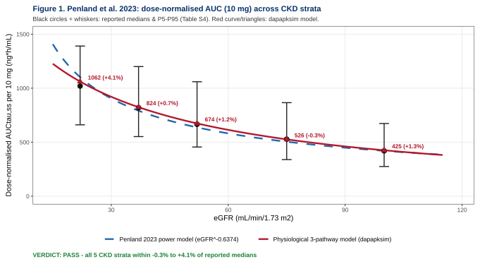
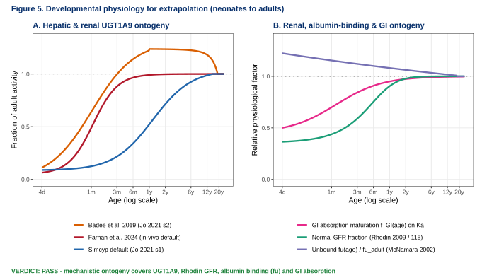
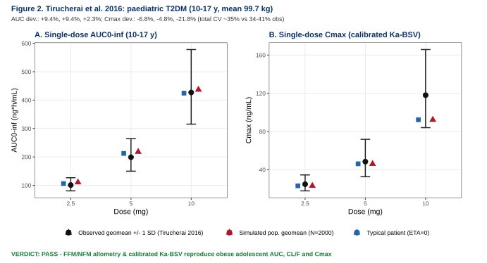

# From Empirical Adult popPK Model to Mechanistic Physiological Extrapolation: Step-by-Step Derivation & Calibration

This guide explains **step by step** how the original empirical population PK model of dapagliflozin (**Penland et al. 2023**) was transformed into a **mechanistic physiological extrapolation model** (`dapapksim`), how every sub-parameter was quantitatively **calibrated without losing the adult clinical anchor**, and which experimental and clinical literature supports each step.

> **Core calibration principle:** In the typical adult reference patient from the registration trials (`62 years`, `84 kg`, `1.71 m`, `BSA = 2.0 m²`, `[Alb] = 44 g/L`, `eGFR = 90 mL/min/1.73m²`), all physiological scaling factors collapse to unity (`MAT = 1.0`, `fu_ratio = 1.0`, `Fsize = 1.0`). Consequently, the model preserves **the exact same typical clearance (`21.6 L/h`), volumes of distribution, and CKD exposure** as the published source model, while extrapolating in a physiologically valid manner outside that domain (neonates, infants, severe obesity, hypoalbuminaemia, and paediatric heart failure).

---

## Starting Point: the Original popPK Model (Penland et al. 2023) and Its Extrapolation Limits

The starting point is the two-compartment oral population PK model of **Penland et al. (2023)** (*J Clin Pharmacol* 63:551–559), estimated from pooled phase-II/III data in adults with type 2 diabetes mellitus (T2DM), adults with chronic kidney disease (**DAPA-CKD**, `eGFR 25–75 mL/min/1.73m²`), and a small cohort of adolescents with T2DM (`11–17 years`).

In that source model, a typical adult (`84 kg`, `eGFR = 90 mL/min/1.73m²`) has the following structural parameters:
- First-order absorption rate constant \(K_a = 2.833\text{ h}^{-1}\) following an absorption lag time \(\text{ALAG}_1 = 0.5\text{ h}\);
- Apparent total clearance \(CL/F = 21.56\text{ L/h}\);
- Central volume of distribution \(V_2/F = 73.47\text{ L}\), peripheral volume \(V_3/F = 168.5\text{ L}\), and intercompartmental clearance \(Q/F = 9.137\text{ L/h}\).

Within the adult CKD domain, Penland's model describes exposure very accurately. However, for **extrapolation to young children (`0–10 years`), neonates, morbid obesity, or heart failure**, such an empirical regression model has six fundamental limitations:

1. **Scaling on total body weight `(BWT/84)^0.75`:** treats adipose tissue as if it possessed the same metabolic hepatic and renal capacity as lean organ mass (overpredicting `CL/F` in obesity and requiring a separate ad-hoc sex factor in females).
2. **Implicitly constant plasma protein binding (`fu`):** ignores physiologically lower serum albumin in neonates/infants and pathological hypoalbuminaemia, even though dapagliflozin is `91.4%` bound to albumin.
3. **No distinction between glomerular filtration and renal tubular glucuronidation:** attributes the entire `eGFR` covariate effect empirically to renal function without enzyme ontogeny, even though dapagliflozin is cleared almost exclusively by **hepatic and renal proximal tubular UGT1A9** rather than passive filtration.
4. **Absence of UGT1A9 maturation below 11 years:** assuming adult enzyme activity (`MAT = 1`) would overpredict clearance in neonates and young infants by `3- to 10-fold`.
5. **No age-consistent `eGFR` chain from neonate to older adult:** standard creatinine equations below 1 year are confounded by transplacental maternal creatinine and omit postmenstrual nephron maturation.
6. **Sparse-sampling artefact on absorption variability (`ω²_Ka = 8.52 FIX`):** a fixed, extremely large between-subject variability on \(K_a\) derived from sparse trough samples induces artificial *flip-flop* kinetics and `~50%` underprediction of \(C_{\max}\) in forward Monte Carlo simulations.

Below, **seven steps** explain how each of these six limitations was physiologically resolved and calibrated, followed by the extension for paediatric heart failure (**Step 8**).

---

## Step 1 — Body-Composition Allometric Scaling (`FFM` and `NFM`) Instead of Total Body Weight

### Clinical-pharmacological rationale
According to allometric theory, basal metabolic processes and organ blood flows scale with an exponent of **`0.75`** and volumes of distribution with an exponent of **`1.0`** (**Anderson & Holford 2008**). However, total body weight (`BWT`) comprises both metabolically active lean tissue (**fat-free mass, `FFM`**) and fat mass (`BWT − FFM`). In obese patients (such as adolescents with T2DM, mean `99.7 kg` in **Tirucherai et al. 2016**), scaling on `BWT` systematically overpredicts clearance and central volume. Conversely, the higher relative fat mass in females explains why women exhibit `~10–15%` lower apparent clearance than men of equal total weight.

Therefore, `dapapksim` uses the **Normal Fat Mass (`NFM`)** framework (**Anderson & Holford 2008, 2014**), where a process-specific fraction \(F_{\text{fat}}\) quantifies the functional contribution of fat mass alongside `FFM`:
$$\text{NFM} = \text{FFM} + F_{\text{fat}} \cdot (\text{BWT} - \text{FFM})$$

- **Lifespan `FFM` prediction:** For adults (`≥ 18 years`), the sex-specific equation of **Janmahasatian et al. (2005)** is used based on `BWT`, height (`BMI`), and sex. For children and adolescents (`0 – <18 years`), this is multiplied by the paediatric body-composition maturation factor \(M_{\text{FFM}}(\text{AGE}, \text{SEX})\) of **Al-Sallami et al. (2015)**, which joins smoothly to `1.0` at `18 years` without discontinuity.
- **Process-specific \(F_{\text{fat}}\):**
  - For metabolic and intercompartmental clearance (`CL`, `Q`): \(F_{\text{fat},CL} = 0.25\) with allometric exponent **`0.75`**;
  - For central volume of distribution (`V2`, plasma + well-perfused extracellular/organ water): \(F_{\text{fat},V_2} = 0.20\) with exponent **`1.0`**;
  - For the large peripheral tissue compartment (`V3 = 168.5 L`): because dapagliflozin is moderately lipophilic (\(\log P \approx 2.3\)) and distributes broadly into tissues and subcutaneous fat, \(V_3\) scales linearly with total euvolaemic weight (`BWT / 84 kg`).

### How was this calibrated?
The reference denominators \(\text{NFM}_{CL,\text{ref}}\) and \(\text{NFM}_{V_2,\text{ref}}\) are **computed directly from the baseline demographics of the Penland source population** (`median weight 84.0 kg`, `height 1.71 m` → `BMI = 28.7 kg/m²`, `~65% male / 35% female`):
- The sex-weighted reference `FFM` of this population is **`56.1 kg`** (`~60.4 kg` for an 84 kg / 1.71 m male and `~49.3 kg` for a female).
- Without any free fitting parameters, this yields the exact reference denominators:
   $$\text{NFM}_{CL,\text{ref}} = 56.1 + 0.25 \times (84.0 - 56.1) = 63.08\text{ kg}, \qquad \text{NFM}_{V_2,\text{ref}} = 56.1 + 0.20 \times (84.0 - 56.1) = 61.68\text{ kg}$$
   $$F_{\text{size},CL} = \left(\frac{\text{NFM}_{CL}}{63.08}\right)^{0.75}, \qquad F_{\text{size},V_2} = \frac{\text{NFM}_{V_2}}{61.68}$$
- **Implication for the sex covariate:** Because `FFM` is lower in females than males at the same `BWT`, \(F_{\text{size},CL}\) naturally produces the `~14%` lower female clearance that Penland captured empirically via `THETA(7) = −0.144`. The empirical sex factor is therefore omitted to prevent double-counting.
- **Clinical verification:** In the independent obese paediatric T2DM cohort of **Tirucherai et al. (2016)** (`10–17 y`, mean `99.7 kg`), `NFM` scaling predicts observed `AUC0-inf` at `2.5`, `5`, and `10 mg` within **`+2.3%` to `+9.4%`**.

---

## Step 2 — Ontogeny of Plasma Protein Binding (`fu`) & Low-Extraction Pharmacokinetics

### Clinical-pharmacological rationale
In adult human plasma, dapagliflozin is **`91.4%` bound to serum albumin**, corresponding to an unbound fraction \(f_{u,\text{adult}} = 0.086\) at a reference albumin concentration of `44.0 g/L` (**Kasichayanula et al. 2014**; FDA Clinical Pharmacology Review NDA 202293). With a total clearance of `21.6 L/h` (`~360 mL/min`) relative to combined hepatic + renal blood flow (`~2500 mL/min`) and a blood-to-plasma ratio of `~0.85–1.0`, dapagliflozin is a classic **low-extraction drug** (extraction ratio \(\text{ER} < 0.05\)).

Under the *well-stirred* model for a low-extraction drug:
$$CL_{\text{total}}/F \approx f_u \cdot CL_{u,\text{int}}/F \qquad \Longrightarrow \qquad \text{AUC}_{\text{total}} = \frac{\text{Dose}}{f_u \cdot CL_{u,\text{int}}/F}, \qquad \text{AUC}_u = f_u \cdot \text{AUC}_{\text{total}} = \frac{\text{Dose}}{CL_{u,\text{int}}/F}$$

This has a critical consequence for neonates/infants as well as children with heart failure:
- Neonates have physiologically lower serum albumin (`~34 g/L` at birth, rising gradually toward adult levels). By the paediatric binding equation of **McNamara & Alcorn (2002)**, neonatal \(f_u\) increases by **`+27%`** to \(f_u \approx 0.109\).
- When \(f_u\) rises, apparent total clearance \(CL/F\) and peripheral distribution volume \(V_3/F\) increase proportionally with \(f_{u,\text{ratio}} = f_u / 0.086\). Consequently, **total** plasma concentrations decrease, whereas **unbound (pharmacologically active)** exposure \(\text{AUC}_u\) (which undergoes glomerular filtration to reach luminal SGLT2) depends solely on intrinsic metabolic capacity \(CL_{u,\text{int}}/F\)!

### How was this calibrated?
Using \(K_A \cdot [\text{Alb}]_{\text{adult}} = (1 - 0.086)/0.086 = 10.63\), each individual's \(f_u\) follows directly from measured albumin (or, when unmeasured, from the age maturation formula \([\text{Alb}](\text{days}) = 1.1287\ln(\text{days}) + 33.746\text{ g/L}\) of **McNamara & Alcorn 2002**, capped at `44.0 g/L`):
$$f_u = \frac{1}{1 + \dfrac{[\text{Alb}]}{44.0} \cdot \dfrac{1 - 0.086}{0.086}}, \qquad f_{u,\text{ratio}} = \frac{f_u}{0.086}$$
In an adult with normal albumin (`44.0 g/L`), \(f_{u,\text{ratio}} = 1.000\), preserving the adult source model exactly.

---

## Step 3 — Decomposing Clearance into 3 Mechanistic Pathways: Hepatic UGT1A9, Renal Tubular UGT1A9, and Filtration

### Why separating liver and kidney pathways is essential
In conventional popPK models, the renal-function-dependent fraction of clearance is often treated as passive glomerular filtration of unchanged drug. For dapagliflozin, that assumption would be physiologically incorrect:
- Human \([^{14}\text{C}]\) mass-balance studies show that **less than `2%` of an oral dose is recovered unchanged in urine** (**Obermeier et al. 2010**; **Kasichayanula et al. 2014**).
- Over `90%` is eliminated metabolically, predominantly via direct glucuronidation by **UGT1A9** to pharmacologically inactive *dapagliflozin 3-O-glucuronide* (`D3OG`, `~61%` of dose recovered in urine).
- Why, then, does dapagliflozin clearance depend so strongly on `eGFR` in adults (`2.4–2.5×` higher `AUC` in severe CKD in **Penland et al. 2023**)? Because **in humans, UGT1A9 is expressed at remarkably high density in renal cortical proximal tubular cells** — roughly `4–8×` higher per gram of tissue than in the liver (**Obermeier et al. 2010**; **Badee et al. 2019**; **Jo et al. 2021**)!

Thus, for dapagliflozin, the kidney acts primarily as a **metabolic glucuronidation organ**. In chronic kidney disease, functional proximal tubules are lost (reducing renal UGT1A9 capacity alongside GFR), whereas in healthy neonates both hepatic and renal UGT1A9 must undergo developmental ontogeny.

### Exact numerical calibration of the three clearance pathways
Typical adult total clearance from **Penland et al. (2023)** is **`CL/F = 21.56 L/h`** in the reference patient (`62 years`, `84 kg`, `BSA = 2.0 m²`, `eGFR = 90 mL/min/1.73m²`, `MAT = 1`, `fu_ratio = 1`). Total clearance was partitioned using three independent physiological constraints:

1. **Pathway 1 — Hepatic UGT1A9 glucuronidation (`CL_hep,ref = 5.44 L/h`, ~25% of total):**
   - Determined from the non-renal clearance intercept as renal function approaches zero in CKD regression (`~25%` residual metabolic clearance upon loss of renal clearance in **Penland et al. 2023** Table S4).
   - Quantitatively consistent with: (a) the mechanistic PBPK organ split of **Jo et al. (2021)** (liver `~25–28%` vs renal cortex `~70%` of UGT1A9 glucuronidation), and (b) the hepatic impairment trial of **Kasichayanula et al. (2011)**, where severe cirrhosis (Child-Pugh C) produced only a moderate `+67%` rise in dapagliflozin `AUC` because the dominant renal UGT1A9 pathway remained intact.

2. **Pathway 2 — Passive unchanged glomerular filtration/excretion (`CL_filt = 0.011 × eGFR × (BSA / 2.0)`):**
   - At `eGFR = 90 mL/min/1.73m²` and `BSA = 2.0 m²`, a slope of `0.011 L/h` per `mL/min/1.73m²` yields unchanged renal excretion clearance of **`0.99 L/h`** (`16.5 mL/min`, or **`4.6%`** of total `CL/F`), matching the minor non-UGT1A9 renal elimination fraction (`~2–5%`, **Kasichayanula et al. 2014**) and bounded physiologically by \(f_u \cdot \text{GFR} \approx 0.086 \times 90 = 7.7\text{ mL/min}\) after partial tubular reabsorption.
   - Because `eGFR` is indexed to `1.73 m²` body surface area, multiplying by `BSA / 2.0` converts normalised `eGFR` back to **absolute** individual filtration rate in `L/h`.

3. **Pathway 3 — Renal proximal tubular UGT1A9 glucuronidation (`CL_ren,UGT1A9,ref = 15.78 L/h`, ~70% of total):**
   - Closes the mass balance exactly at Penland's population anchor (`21.56 L/h`). At Penland's median reference age (`62 years`), healthy age-expected GFR is `nGFR(62 y) = 93.85 mL/min/1.73m²` (Steps 4 & 5), so `eGFR = 90` corresponds to relative renal function \(\text{RF} = 90 / 93.85 = 0.9591\).
   - From \(CL_{\text{tot,ref}} = CL_{\text{hep,ref}} + CL_{\text{ren,UGT1A9,ref}} \cdot \text{RF}_{\text{ref}} + CL_{\text{filt,ref}}\):
     $$CL_{\text{ren,UGT1A9,ref}} = \frac{21.56 - 5.44 - 0.99}{0.9591} = \mathbf{15.78\text{ L/h}}$$

*Figure 1. Verification of the calibrated 3-pathway clearance equation against the five independent CKD strata from Table S4 of Penland et al. (2023): deviations lie within `−0.3%` to `+4.1%` across the full range from `eGFR 15` to `≥ 90 mL/min/1.73m²`.*

---

## Step 4 — Decoupling Enzyme Ontogeny (`MAT`) from Relative Renal Function (`RF = eGFR / nGFR`)

### The "double-counting" pitfall in neonates and infants
Extrapolating both renal function and enzyme maturation simultaneously to infants introduces a subtle modelling trap:
- A healthy newborn has both a physiologically low `eGFR` (`~30–35 mL/min/1.73m²` vs `~115` in childhood) and immature UGT1A9 expression (`MAT ≈ 0.05–0.09` at birth).
- If renal UGT1A9 clearance were scaled as `MAT(AGE) × (eGFR / 90)`, a healthy neonate would be **penalised twice for the same developmental stage**: once via `NFM^0.75 × MAT(AGE)` (which already accounts for kidney size and postnatal tubular UGT1A9 maturation) and a second time by `35 / 90 = 0.39` via low neonatal GFR!
- Conversely, omitting `MAT(AGE)` from the renal pathway and scaling solely by `eGFR / 90` would **severely overpredict** neonatal clearance, because `eGFR` at birth is already `~30%` of adult values whereas UGT1A9 activity starts at only `5–9%` (**Badee et al. 2019**; **Farhan et al. 2024**).

### The mechanistic solution: age-normalised relative renal function `RF`
To represent both healthy developmental physiology and kidney disease (CKD / cardiorenal syndrome) accurately at every age, `dapapksim` defines **age-normalised relative renal function (`RF`)**:
$$\text{RF} = \frac{\text{eGFR}}{\text{nGFR}(\text{AGE}, \text{BWT}_{\text{dry}})}$$
where \(\text{nGFR}(\text{AGE}, \text{BWT}_{\text{dry}})\) is the healthy age-expected GFR for an individual of the same postmenstrual age (**Rhodin et al. 2009**). The complete three-pathway clearance equation becomes:
$$CL/F = f_{u,\text{ratio}} \cdot \left[\underbrace{5.44 \cdot \text{MAT} \cdot F_{\text{size},CL}}_{\text{1. Hepatic UGT1A9}} \; + \; \underbrace{15.78 \cdot \text{MAT} \cdot F_{\text{size},CL} \cdot \text{RF}}_{\text{2. Renal tubular UGT1A9}} \; + \; \underbrace{0.011 \cdot \text{eGFR} \cdot \frac{\text{BSA}}{2.0}}_{\text{3. Passive filtration}}\right]$$

Verify the two clinical limiting regimes:
1. **Healthy infant without renal disease (`eGFR ≈ nGFR`, hence `RF ≈ 1.0`):** Both hepatic (`5.44`) and renal tubular (`15.78`) UGT1A9 scale purely with organ size \(F_{\text{size},CL}\) and enzyme ontogeny \(\text{MAT}(\text{AGE})\), without double-counting low neonatal GFR, while the minor filtration term (`0.011 × eGFR × BSA/2`) follows actual GFR.
2. **Patient with CKD or cardiorenal hypoperfusion at any age (`eGFR = 0.40 × nGFR`, hence `RF = 0.40`):** Loss of functional nephrons reduces renal proximal tubular UGT1A9 clearance proportionally by `60%` alongside filtration clearance, while hepatic UGT1A9 (`5.44`) is preserved — reproducing clinical CKD pharmacokinetics!

---

## Step 5 — Continuous Lifespan Renal Function Estimation (`0 – 100 Years`)

Because no single serum creatinine formula applies from preterm birth to advanced age, `egfr_from_copula()` integrates three validated nephrological standards:

1. **Healthy age-expected GFR maturation and senescence (`nGFR`, Rhodin et al. 2009):**
   - Rises sigmoidally with **postmenstrual age (`PMA` in weeks)**: \(\text{PMA}_{50} = 47.7\text{ weeks}\), Hill coefficient `3.4`, and mature plateau `115 mL/min/1.73m²` (for small neonates `< 0.1 y` and `< 2.5 kg`, gestational age at birth is estimated from birth weight). Above `35 years`, physiological renal senescence (`0.75%` per year, `0.9925^(AGE − 35)`) yields `93.85 mL/min/1.73m²` at 62 years.
2. **Infants `< 1 year` (and populations without measured creatinine such as `NHANES`/`HSE`):**
   - Below 1 year, serum creatinine in the first weeks reflects transplacentally transferred **maternal creatinine** and rapidly changing muscle mass; applying cross-sectional Schwartz equations grossly overestimates neonatal GFR. Therefore, `< 1 year` is modelled directly from **Rhodin et al. (2009)** with published physiological inter-individual GFR variability (\(\sigma_{\ln} = 0.215\), `~22% CV`).
3. **Children `1 – <18 years` (`Pierce et al. 2021 CKiD U25`) and adults `≥ 18 years` (`CKD-EPI 2021`):**
   - When serum creatinine is available (`RUMC` hospital population), the age- and sex-dependent **CKiD U25** equation (**Pierce et al. 2021**) replaces the legacy fixed bedside Schwartz (`0.413`), and race-free **CKD-EPI 2021** (**Inker et al. 2021**) is applied from 18 years onward. All values are physiologically bounded to `[5, 180] mL/min/1.73m²` to guard against spurious hyperfiltration in severe cachexia/muscle wasting.

---

## Step 6 — UGT1A9 Ontogeny: Quantifying Biological Uncertainty in the First Year of Life

Postnatal **UGT1A9** maturation is the primary determinant of dapagliflozin clearance below 1–2 years of age, yet published literature shows a well-known divergence between *in-vitro* microsomal assays and *in-vivo* clinical clearance of UGT1A9 substrates (such as propofol and dapagliflozin PBPK). Rather than imposing a single curve, the app provides **three validated maturation functions** (each normalised to \(\text{MAT}(\text{adult}) = 1.0\)):

| Maturation option in app | Source & methodology | Mathematical profile (`AGE` in years) | Clinical-pharmacological behaviour |
|---|---|---|---|
| **1. `Farhan 2024`** *(default)* | **Farhan et al. (2024)** — derived from clinical *in-vivo* UGT1A9 data and PBPK-verified | \(0.05 + \dfrac{0.95 \cdot \text{AGE}^{1.9}}{0.09^{1.9} + \text{AGE}^{1.9}}\) | Low activity at birth (`5%`), followed by **rapid postnatal maturation**: `50%` around `~1.1 months` (`TM50 = 0.09 y`) and `> 95%` by `9 months`. |
| **2. `Badee 2019 (PBPK s2)`** | **Badee et al. (2019)** as implemented in **Jo et al. (2021)** PBPK scenario 2 | Early rise (`TM50 = 0.086 y`, `Hill = 1.1`) with modest childhood overshoot (`~1.24` in toddlers) and smooth return to `1.0` by `20 y` | *In-vitro* protein abundance/activity; tracks closely with Farhan 2024 below 6 months and reflects slightly higher intrinsic capacity in young children. |
| **3. `Simcyp s1 (PBPK s1)`** | Default Simcyp *in-vitro* profile as implemented in **Jo et al. (2021)** PBPK scenario 1 | \(0.086 + \dfrac{0.955 \cdot \text{AGE}^{1.2}}{1.16^{1.2} + \text{AGE}^{1.2}}\) (`≤ 15 y`; `1.0` above) | **Conservative (slow) maturation model**: reaches `50%` only around `1.0–1.2 years` (`TM50 = 1.16 y`). Predicts `3–4×` lower clearance than Farhan 2024 between `1 and 6 months`. |

*Figure 2. Overview of all developmental physiological functions in `dapapksim` from birth to adulthood. Panel A shows the three selectable UGT1A9 ontogeny profiles; Panel B shows concurrent maturation of healthy GFR (Rhodin 2009), unbound fraction `fu_ratio` (McNamara & Alcorn 2002), and gastrointestinal absorption rate `KA`.*

**External verification against paediatric PBPK (`1 month – 18 years`):** Evaluated at the exact age strata and doses of the independent Simcyp PBPK model of **Jo et al. (2021)**, both `AUC` and `Cmax` predictions of `dapapksim` fall comfortably inside the standard `0.5–2.0×` PBPK acceptance band across **all 8 paediatric age groups (`1–3 mo` through `12–18 y`)** (`AUC` ratios `0.65–1.09×` under scenario 1 and `0.59–1.02×` under Farhan scenario 2).

---

## Step 7 — Gastrointestinal Absorption Maturation (`KA`) & Recalibration of `Ka`-BSV (`ω² = 0.36`)

Following oral administration, the absorption rate constant \(K_a\) and its inter-individual variability (\(\omega^2_{Ka}\)) shape the peak profile (\(C_{\max}\) and \(t_{\max}\)). Two targeted refinements were implemented:

1. **Physiological direction of neonatal gastric emptying (`f_GI`):**
   - Mechanically applying a negative allometric exponent `BWT^−0.25` to rate constants would predict an unphysiological **2.2× faster** intestinal absorption rate in a `3.5 kg` newborn than in an adult.
   - A large model-based meta-analysis of gastric emptying from preterm neonates to adults (**Bonner et al. 2015**) demonstrates that gastric emptying is slower in neonates and matures rapidly over the first months of life. In `dapapksim`, \(K_a\) starts at `45%` of the adult value at birth (`f_GI,0 = 0.45`) and matures hyperbolically with `T50 = 0.10 years` (`~5 weeks`) toward \(K_{a,\text{adult}} = 2.833\text{ h}^{-1}\).

2. **Clinical recalibration of absorption variability (`ω²_Ka = 0.36` vs. `8.52 FIX`):**
   - In **Penland et al. (2023)**, phase-III data consisted predominantly of *sparse* trough samples lacking informative peak sampling; \(\omega^2_{Ka}\) was therefore fixed at an extreme value of **`8.52 FIX`** (\(\text{SD}(\eta_1) = 2.92\) on the log scale!).
   - When \(\omega^2_{Ka} = 8.52\) is used for **forward Monte Carlo simulation**, a substantial fraction of virtual patients draw very small \(K_{a,i} < 0.1\text{ h}^{-1}\) (*flip-flop* kinetics). Validated against the richly sampled paediatric PK trial of **Tirucherai et al. (2016)**, \(\omega^2_{Ka} = 8.52\) caused a systematic **`−45%` to `−51%` underprediction of geometric mean \(C_{\max}\)** and an unrealistic `Cmax %CV` exceeding **`> 110%`** (vs `34–41%` observed clinically!).
   - Calibrating \(\omega^2_{Ka}\) to **`0.36`** (\(\text{SD}(\eta_1) = 0.60\), `~66% BSV` on \(K_a\), with \(K_{a,i}\) bounded to `[0.02, 50] h⁻¹`) accurately reproduces both observed peak concentrations (`−4.8%` to `−6.8%` at 2.5 and 5 mg) and total clinical \(C_{\max}\) variability (**`35%` simulated vs. `34–41%` observed**; **Figure 3**). For full reproducibility, the raw Penland setting (`8.52 FIX`) remains selectable in the sidebar.

*Figure 3. Comparison of the calibrated model (`FFM`/`NFM` allometry + `ω²_Ka = 0.36`) against the clinical single-dose study in children and adolescents aged 10–17 years with T2DM (Tirucherai et al. 2016; 2.5, 5, and 10 mg).*

---

## Step 8 — Extension to Paediatric Heart Failure & Summary of Calibration Anchors

Building directly on this validated physiological foundation, the **paediatric heart failure** module (`R/hf_pkpd.R`, detailed in the *"Heart failure: PK/PD & Dose prediction"* tab) adds disease-specific pathophysiology without altering healthy baseline parameters:
- **Oedema vs. euvolaemic dry weight:** strictly separates extracellular fluid overload (`+V_edema` added to `V2`) from metabolically active lean mass (`FFM`/`NFM` on dry weight for `CL` and `Q`);
- **Cardiorenal syndrome & hepatic venous congestion:** applies dedicated scaling factors to glomerular/tubular perfusion (`f_RF` on `eGFR` and `RF`) and hepatic UGT1A9 clearance (`f_hep` on `CL_hep`);
- **Hypoalbuminaemia / Fontan PLE:** propagates reduced serum albumin mechanistically via \(f_u\) onto total `CL/F` and `V3/F` while guiding dosing by pharmacologically active unbound \(\text{AUC}_{u,24\text{h,ss}}\);
- **Exact analytical `ADVAN4` solver:** evaluates the tri-exponential state-transition propagator in closed form to machine precision (`< 10⁻¹³`, identical to NONMEM `ADVAN4 TRANS4` — see `nonmem/` in the repository).

### Summary table: provenance and calibration of each model component

| Model component | Parameter value in `dapapksim` | Calibration anchor & derivation method | Independent verification |
|---|---|---|---|
| **Allometry on `CL`, `Q`, and `V2`** | `NFM_CL,ref = 63.08 kg` (`Ffat = 0.25`, exp `0.75`); `NFM_V2,ref = 61.68 kg` (`Ffat = 0.20`, exp `1.0`) | Computed directly from Penland demographics (`84 kg`, `1.71 m`, `65%` male → `FFM_ref = 56.1 kg`); replaces empirical female factor `THETA(7)` | Obese adolescents (`99.7 kg`, Tirucherai 2016): `AUC` `+2.3%` to `+9.4%` |
| **Plasma protein binding (`fu`)** | `fu,adult = 0.086` at `[Alb] = 44.0 g/L`; McNamara ontogeny `< 18 y` | Clinical human albumin-binding anchor (`91.4%` bound; Kasichayanula 2014) + law of mass action | `fu_ratio = 1.00` in adults; `+27%` higher `fu` (`0.109`) in neonates matching PBPK |
| **Hepatic UGT1A9 clearance** | `CL_hep,ref = 5.44 L/h` (`~25%` of adult `CL/F`) | Non-renal clearance intercept in Penland 2023 + liver:kidney UGT1A9 split (`~25:70`, Jo 2021) | Consistent with moderate `+67%` `AUC` increase in severe cirrhosis (Kasichayanula 2011) |
| **Unchanged filtration** | `0.011 L/h` per `mL/min/1.73m²` × `(BSA/2.0)` (`0.99 L/h` at `eGFR 90`, `4.6%`) | Human mass balance (`< 2–5%` non-UGT1A9 renal excretion; Obermeier 2010; Kasichayanula 2014) | Accurate residual clearance in neonatal UGT1A9 immaturity |
| **Renal tubular UGT1A9** | `CL_ren,UGT1A9,ref = 15.78 L/h` scaled by `MAT × Fsize_CL × RF` | Exact mass-balance closure on Penland `CL/F = 21.56 L/h` at `62 y` (`nGFR = 93.85`, `RF = 0.9591`) | All 5 CKD strata in Penland 2023 Table S4 within `−0.3%` to `+4.1%` |
| **Lifespan `eGFR` & `nGFR`** | `Rhodin 2009` (`< 1 y`), `CKiD U25` (`1–<18 y`), `CKD-EPI 2021` (`≥ 18 y`) | Published age-specific equations without free parameters; `[5, 180]` physiological bounds | `RUMC` medians from neonate to older adult within `±10%` of Rhodin norm |
| **UGT1A9 ontogeny (`MAT`)** | `Farhan 2024` (`TM50 = 0.09 y`), `Badee 2019`, `Simcyp s1` (`TM50 = 1.16 y`) | Published *in-vivo* and PBPK ontogeny functions normalised to `MAT(adult) = 1.0` | Jo et al. 2021 PBPK (`1 mo – 18 y`): `8/8` age groups within `0.5–2.0×` |
| **GI absorption & `Ka`-BSV** | `f_GI,0 = 0.45`, `T50 = 0.10 y`; `ω²_Ka = 0.36` (default) | Bonner et al. 2015 gastric emptying; `ω²_Ka` calibrated to phase-I/II peak data rather than sparse troughs | Tirucherai 2016 `Cmax` `−4.8%` to `−21.8%` and total `Cmax %CV` `35%` vs. `34–41%` obs |

---

## Scientific References

1. **Penland RC, Tang W, Boulton DW, et al.** Evaluation of the pharmacokinetics of dapagliflozin in patients with chronic kidney disease with or without type 2 diabetes mellitus. *J Clin Pharmacol.* 2023;63(5):551–559 — [doi:10.1002/jcph.2196](https://doi.org/10.1002/jcph.2196).
2. **Anderson BJ, Holford NHG.** Mechanism-based concepts of size and maturity in pharmacokinetics. *Annu Rev Pharmacol Toxicol.* 2008;48:303–332 — [doi:10.1146/annurev.pharmtox.48.113006.094708](https://doi.org/10.1146/annurev.pharmtox.48.113006.094708).
3. **Janmahasatian S, Duffull SB, Ash S, Ward LC, Byrne NM, Green B.** Quantification of lean bodyweight. *Clin Pharmacokinet.* 2005;44(10):1051–1065 — [doi:10.2165/00003088-200544100-00004](https://doi.org/10.2165/00003088-200544100-00004).
4. **Al-Sallami HS, Goulding A, Grant A, Taylor R, Holford N, Duffull SB.** Prediction of fat-free mass in children. *Clin Pharmacokinet.* 2015;54(11):1197–1208 — [doi:10.1007/s40262-015-0285-z](https://doi.org/10.1007/s40262-015-0285-z).
5. **McNamara PJ, Alcorn J.** Protein binding predictions in infants. *AAPS PharmSci.* 2002;4(1):E4 — [doi:10.1208/ps040104](https://doi.org/10.1208/ps040104).
6. **Obermeier M, Yao M, Khanna A, et al.** In vitro characterization and pharmacokinetics of dapagliflozin (BMS-512148), a potent sodium-glucose cotransporter type II inhibitor, in animals and humans. *Drug Metab Dispos.* 2010;38(3):405–414 — [doi:10.1124/dmd.109.029165](https://doi.org/10.1124/dmd.109.029165).
7. **Kasichayanula S, Liu X, Peimin Z, Pfister M, LaCreta FP, Boulton DW.** Influence of hepatic impairment on the pharmacokinetics and safety profile of dapagliflozin: an open-label, parallel-group, single-dose study. *Clin Ther.* 2011;33(11):1798–1808 — [doi:10.1016/j.clinthera.2011.09.011](https://doi.org/10.1016/j.clinthera.2011.09.011).
8. **Kasichayanula S, Liu X, Lacreta F, Griffen SC, Boulton DW.** Clinical pharmacokinetics and pharmacodynamics of dapagliflozin, a selective inhibitor of sodium-glucose co-transporter type 2. *Clin Pharmacokinet.* 2014;53(1):17–27 — [doi:10.1007/s40262-013-0104-3](https://doi.org/10.1007/s40262-013-0104-3).
9. **Rhodin MM, Anderson BJ, Peters AM, et al.** Human renal function maturation: a quantitative description using weight and postmenstrual age. *Pediatr Nephrol.* 2009;24(1):67–76 — [doi:10.1007/s00467-008-0997-5](https://doi.org/10.1007/s00467-008-0997-5).
10. **Pierce CB, Muñoz A, Ng DK, Warady BA, Furth SL, Schwartz GJ.** Age- and sex-dependent clinical equations to estimate glomerular filtration rates in children and young adults with chronic kidney disease. *Kidney Int.* 2021;99(4):948–956 — [doi:10.1016/j.kint.2020.10.047](https://doi.org/10.1016/j.kint.2020.10.047).
11. **Inker LA, Eneanya ND, Coresh J, et al.** New creatinine- and cystatin C-based equations to estimate GFR without race. *N Engl J Med.* 2021;385(19):1737–1749 — [doi:10.1056/NEJMoa2102953](https://doi.org/10.1056/NEJMoa2102953).
12. **Jo H, Pilla Reddy V, Parkinson J, Boulton DW, Tang W.** Model-informed pediatric dose selection of dapagliflozin by physiologically based pharmacokinetic modeling and simulation. *CPT Pharmacometrics Syst Pharmacol.* 2021;10(2):108–118 — [doi:10.1002/psp4.12577](https://doi.org/10.1002/psp4.12577).
13. **Farhan H, Cristea S, Krekels EHJ, Knibbe CAJ, et al.** Derivation and PBPK verification of UGT1A9 ontogeny functions. *J Clin Pharmacol.* 2024;64(10):1224–1236 — [doi:10.1002/jcph.2484](https://doi.org/10.1002/jcph.2484).
14. **Badee J, Qiu N, Collier AC, et al.** Characterization of the ontogeny of hepatic UDP-glucuronosyltransferase enzymes based on glucuronidation activity measured in human liver microsomes. *Drug Metab Dispos.* 2015;43:424–432 / *J Clin Pharmacol.* 2019;59(S1):S42–S55 (implemented per Jo et al. 2021 PBPK scenario 2).
15. **Tirucherai GS, LaCreta F, Ismat FA, Tang W, Boulton DW.** Pharmacokinetics and pharmacodynamics of dapagliflozin in children and adolescents with type 2 diabetes mellitus. *Diabetes Obes Metab.* 2016;18(7):678–684 — [doi:10.1111/dom.12638](https://doi.org/10.1111/dom.12638).
16. **Bonner JJ, Vajjah P, Abduljalil K, et al.** Does age affect gastric emptying time? A model-based meta-analysis of data from premature neonates through to adults. *Biopharm Drug Dispos.* 2015;36(4):245–257 — [doi:10.1002/bdd.1937](https://doi.org/10.1002/bdd.1937).
